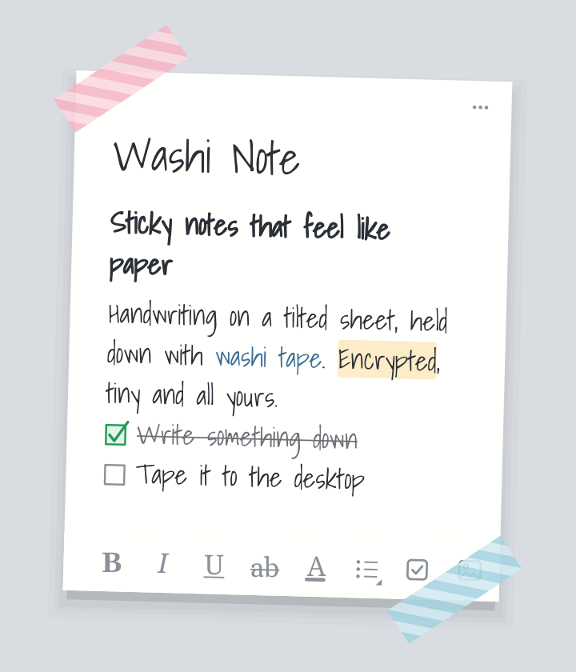
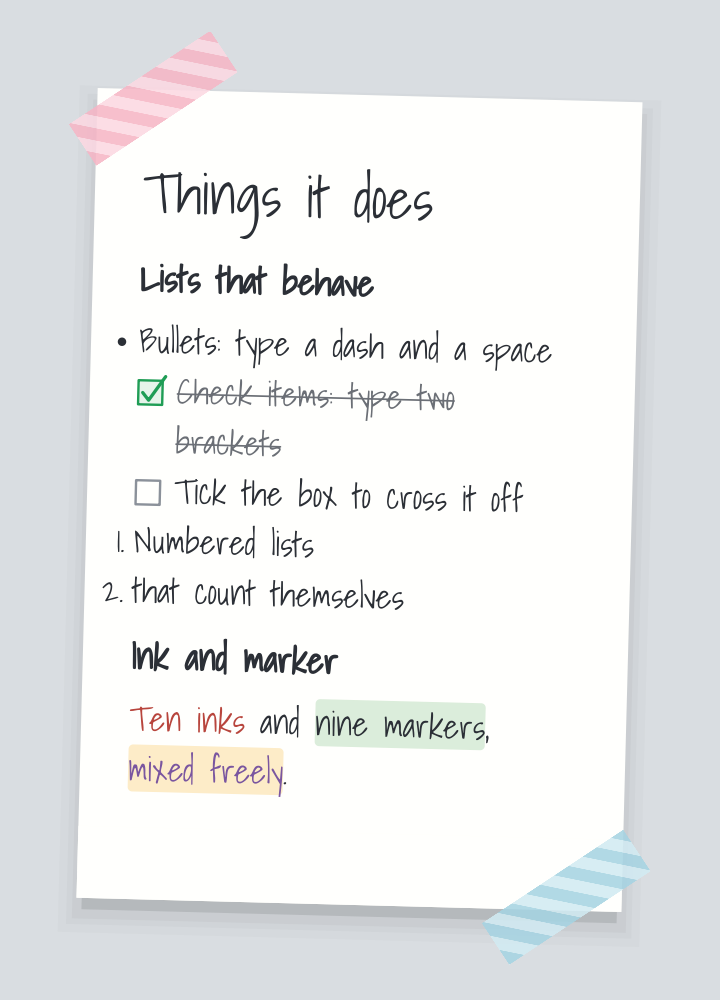
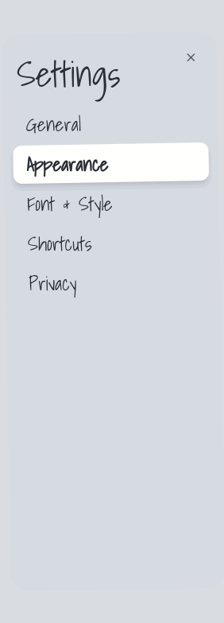
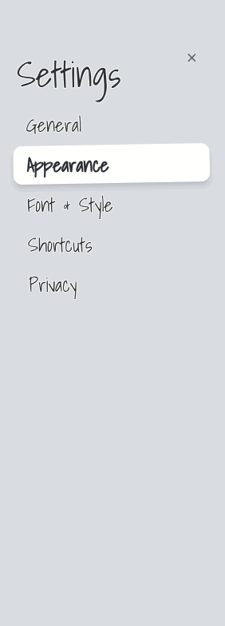
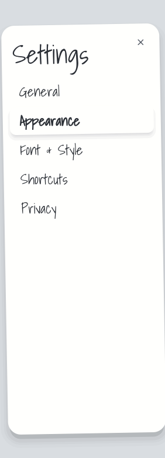
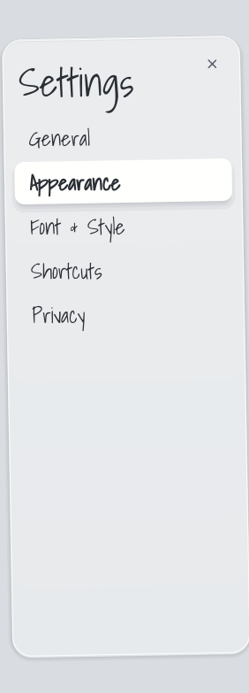

<h1 align="center">Washi Note</h1>

<p align="center">
  <b>Sticky notes that feel like paper.</b><br>
  Handwriting on a tilted sheet, held down with washi tape, locked in an encrypted database.<br>
  One small exe for Windows. No account, no cloud, no telemetry.
</p>

<p align="center">
  
</p>

<p align="center">
  <a href="#install">Install</a> ·
  <a href="#what-a-note-can-do">Features</a> ·
  <a href="#shortcuts">Shortcuts</a> ·
  <a href="#your-notes-are-yours">Privacy</a> ·
  <a href="#build-from-source">Build</a>
</p>

---

## Why Washi

Most sticky-note apps are a yellow rectangle with a text box in it. Washi is a piece of paper.

- **Every note is its own sheet.** A slightly tilted Paper with two strips of tape, floating on your desktop. No window frame, no title bar.
- **The text is tilted too.** The caret, the selection and what you type all sit on the paper's baseline, not on a level grid laid over it.
- **The toolbar stays out of the way.** It appears when the pointer is over the note and is gone when you are just reading.
- **It is small.** Three open notes use about 3 MB of memory, drop under 1 MB when you switch away, and wake in under 20 ms.
- **It is private by construction.** The database is encrypted on disk and unlocked by your Windows account. Nothing is sent anywhere.

## What a note can do

<table>
<tr>
<td width="46%">
  
</td>
<td>

**Write the way you type**

| Type this at the start of a line | Get |
|---|---|
| `- ` | a bulleted list item |
| `1. ` | a numbered item (the numbers count themselves) |
| `[] ` | a check item you can tick off |

`Tab` indents a list, `Shift+Tab` brings it back.

**Format it**

Bold, italic, underline and strikethrough from the toolbar or the keyboard, plus a title and headings.

**Ink and marker**

Ten ink colors and nine highlighter colors, on a selection or on whatever you type next.

**Pictures**

Add a PNG or JPEG from the toolbar, or paste one from the clipboard, and open it in the built-in viewer.

**Undo, properly**

Every edit, color pick and list change is one undo step.

</td>
</tr>
</table>

### All notes

The `⋯` menu on any note lists your notes, makes a new one and opens **All notes**: a sidebar that slides out of the left of the Paper with every note, open or closed. Closing a note keeps it there; deleting asks first, then it is final.

### Make it yours

**Settings** replaces the note with five tabs: General, Appearance, Font & Style, Shortcuts and Privacy.

<p align="center">
  
  
  
  
</p>
<p align="center"><sub>Sidebar themes: Default, Transparent, Paper, Liquid glass</sub></p>

- **Any font you like.** Shadows Into Light is bundled. Install more by dropping a Google Fonts `.zip` or a `.ttf` onto the Font manager. Each font gets its own Weight, Width and Slant sliders, and bold and italic work even in a font that ships a single style.
- **Font size** from 12 to 40. Titles, headings, line spacing, bullets and check boxes scale with it.
- **Tape colors**, sidebar themes, UI size, always on top, start with Windows.
- **Tilted editing** on or off: keep the text on the paper's slant while you type, or let it settle flat and tilt again when you are done.

## Install

Washi runs on **Windows 10 and 11, 64-bit**.

### With the installer (recommended)

1. Download `WashiNote-0.1.0-setup.exe` from the [Releases page](https://github.com/rikzafm/washi/releases).
2. Run it. It installs for your user only, so there is **no administrator prompt**.
3. Windows SmartScreen will warn you, because the installer is not code-signed yet. Choose **More info**, then **Run anyway**.
4. Follow the wizard. A desktop shortcut is optional; a Start menu shortcut is always added.
5. Washi starts when the wizard finishes. Your first note is waiting.

| | Where |
|---|---|
| The app | `%LOCALAPPDATA%\Programs\Washi` |
| Notes, settings, installed fonts | `%APPDATA%\Washi` |

### Portable

Washi is a single `washi.exe` with no DLLs. Put it anywhere and run it. Notes still live in `%APPDATA%\Washi`.

### Updating

Run the newer installer over the old one. Your notes, settings and fonts are not touched.

### Uninstalling

Use **Windows Settings › Apps**, or **Settings › General › Uninstall** inside Washi. This removes the app, its shortcuts and its "Start with Windows" entry.

Your notes are **kept** in `%APPDATA%\Washi`. Delete that folder yourself if you want them gone too.

## Shortcuts

| Action | Keys |
|---|---|
| New note | `Ctrl` `N` |
| Close note | `Ctrl` `W` |
| Delete note | `Ctrl` `D` |
| Bold | `Ctrl` `B` |
| Italic | `Ctrl` `I` |
| Underline | `Ctrl` `U` |
| Strikethrough | `Ctrl` `Shift` `X` |
| List | `Ctrl` `Shift` `L` |
| Check item | `Ctrl` `Shift` `C` |
| Select all | `Ctrl` `A` |
| Undo / Redo | `Ctrl` `Z` / `Ctrl` `Y` |

Shortcuts use the letter your keyboard layout types, so they may not work with a non-Latin layout. The toolbar and the `⋯` menu always do.

## Your notes are yours

- **Locked on disk.** Notes are stored in a SQLCipher-encrypted database.
- **Unlocks with your Windows account.** The key is protected by Windows (DPAPI). There is no password to remember or type.
- **Stays on this computer.** Washi makes no network connections. Fonts you install stay local as well.

> [!WARNING]
> There is no backup of the key. If your Windows profile is reset, or you copy the database to another account or computer, the notes cannot be opened. Use **Export as Markdown** on the notes you want to keep a copy of. It writes a plain `.md` file with the note's pictures as PNG files beside it.

## Light on your machine

Measured on a release build at 100% display scale. Details are in [docs/PERF.md](docs/PERF.md).

| | Measured |
|---|---|
| Memory, 3 notes open | 2.9 MB |
| Memory, 3 notes, suspended | 0.3 to 0.9 MB |
| Startup | about 147 ms |
| Wake from suspended | 9 to 18 ms |
| CPU when suspended | 0 |
| Download | one 13 MB exe, no DLLs |

Washi draws on the CPU with Slint's software renderer, so it needs no GPU and loads no graphics driver.

## Build from source

You need:

- [Rust](https://rustup.rs) (stable, MSVC toolchain)
- [Strawberry Perl](https://strawberryperl.com) on your `PATH`, ahead of Git's Perl. The bundled SQLCipher builds OpenSSL, and OpenSSL's build needs it.

Run it:

```bash
cargo run --release
```

Build the exe (`target\release\washi.exe`):

```bash
cargo build --release -p washi
```

Build the installer (`target\installer\WashiNote-<version>-setup.exe`). This needs [Inno Setup 6](https://jrsoftware.org/isinfo.php):

```bash
winget install JRSoftware.InnoSetup
```

```bash
pwsh tools/build-installer.ps1
```

Run the tests:

```bash
cargo test --workspace
```

### Around the repo

| Path | What is there |
|---|---|
| `washi/` | The app: Rust in `src/`, the Slint UI in `ui/` |
| `tools/snap/` | Renders the real note headlessly; home of the UI tests and the screenshots on this page |
| `tools/uidiff/` | Compares renders against the design mockups |
| `installer/` | The Inno Setup script |
| `docs/adr/` | Architecture decisions |
| `GLOSSARY.md` | The words Washi uses for its own parts |

## Known limits

- Windows only.
- Formatting is per paragraph. Only text color and highlight are per character.
- Pictures are drawn level, not tilted with the paper.
- `.otf` fonts with CFF outlines are not supported. Use the `.ttf`.

The full list is in the [release notes](docs/RELEASE_NOTES.md).

## License

[MIT](LICENSE). The bundled fonts are under the SIL Open Font License; see `fonts/`.
